<div align="center">
  

  <br /><br />

  <!-- Animated Typing Tagline (monochrome, adapts to dark & light mode) -->
  <a href="https://a-hashem-three.vercel.app/">
    <picture>
      <source media="(prefers-color-scheme: dark)" srcset="https://readme-typing-svg.demolab.com?font=Fira+Code&weight=600&size=20&duration=3200&pause=900&color=F4F4F5&center=true&vCenter=true&multiline=false&width=720&height=42&lines=Co-Founder+%26+Lead+Engineer+%40+Folosy;Building+AI-Integrated+%26+Local-First+Products;Front-End%2C+Mobile+(React+Native+%2B+Kotlin)+%26+Full-Stack;Your+fav+web+developer+indeed." />
      <source media="(prefers-color-scheme: light)" srcset="https://readme-typing-svg.demolab.com?font=Fira+Code&weight=600&size=20&duration=3200&pause=900&color=18181B&center=true&vCenter=true&multiline=false&width=720&height=42&lines=Co-Founder+%26+Lead+Engineer+%40+Folosy;Building+AI-Integrated+%26+Local-First+Products;Front-End%2C+Mobile+(React+Native+%2B+Kotlin)+%26+Full-Stack;Your+fav+web+developer+indeed." />
      
    </picture>
  </a>

  <br />

  <!-- Socials & Visitor Counter -->
  <p>
    <a href="https://a-hashem-three.vercel.app/" target="_blank">
      
    </a>
    <a href="https://linkedin.com/in/ahmedhashem" target="_blank">
      
    </a>
    <a href="mailto:a.hashem.shokry123@gmail.com">
      
    </a>
    
  </p>
</div>

---

### 👋 About Me

```ts
const ahmed = {
  location: "Egypt 🇪🇬",
  role: "Co-Founder & Lead Engineer @ Folosy",
  previous: "Solo Front-End Lead @ Edulga",
  education: "BSc in Computer Science — Zagazig University",
  obsessions: [
    "Local-first & privacy-first apps",
    "AI & agentic workflows (MCP, SSE streaming, tool calling)",
    "Silky-smooth web & mobile UIs",
  ],
  ships: "End-to-end — from architecture to production release",
  funFact: "My SQLite databases run in WAL mode and my coffee runs in an infinite loop ☕",
};
```

- **Currently building Folosy** — a privacy-first, local-first personal finance app built with **React Native, SQLite, and native Android (Kotlin)**, featuring an on-device SMS parser across 10+ Egyptian banks & wallets and client-side encrypted Google Drive backups.
- **Previously at Edulga** — led the frontend solo in **Next.js, React & TypeScript**, shipping roadmap generation, live streaming, React Flow canvases, and real-time SSE AI agent interfaces.
- **Always exploring** — Model Context Protocol (MCP), multi-agent orchestration, offline sync, and developer tooling.

---

### 🐍 Contribution Snake

<div align="center">
  <picture>
    <source media="(prefers-color-scheme: dark)" srcset="https://raw.githubusercontent.com/he4a00/he4a00/output/github-contribution-grid-snake-dark.svg" />
    <source media="(prefers-color-scheme: light)" srcset="https://raw.githubusercontent.com/he4a00/he4a00/output/github-contribution-grid-snake.svg" />
    
  </picture>
</div>

---

### 🛠️ Tech Stack & Toolbox

<div align="center">

#### Front-End & Mobile
[](https://skillicons.dev)

-18181b?style=flat-square&logo=react&logoColor=ffffff)


#### AI & Agentic Systems
-18181b?style=flat-square&logo=anthropic&logoColor=ffffff)

-18181b?style=flat-square&logo=lightning&logoColor=ffffff)


#### Back-End, Databases & Tools
[](https://skillicons.dev)


</div>

---

### 🚀 Featured Projects

<table>
  <tr>
    <td width="50%" valign="top">
      <h3>💸 Folosy <sub><i>(Private · Co-Founder &amp; Lead Engineer)</i></sub></h3>
      <p>Privacy-first, local-first personal finance app with an on-device SMS parser across 10+ Egyptian banks &amp; wallets, lock-screen privacy redaction, atomic balance updates, and encrypted Google Drive backup.</p>
      <p>
        <code>React Native</code> <code>SQLite</code> <code>Kotlin</code> <code>Local-First</code>
      </p>
    </td>
    <td width="50%" valign="top">
      <a href="https://github.com/he4a00/note-it">
        <h3>📝 NoteIT</h3>
      </a>
      <p>Full-stack collaborative notes &amp; knowledge workspace with rich-text editing, hierarchical folders, multi-tenant tagging, search, comments, mentions, and RBAC.</p>
      <p>
        <code>Next.js</code> <code>TypeScript</code> <code>tRPC</code> <code>Prisma</code> <code>PostgreSQL</code> <code>Better Auth</code>
      </p>
    </td>
  </tr>
  <tr>
    <td width="50%" valign="top">
      <a href="https://github.com/he4a00/centers-management-system">
        <h3>🏫 Center Management System</h3>
      </a>
      <p>Multi-tenant SaaS for tutoring centers automating student enrollment, teacher scheduling, payments, subscriptions, tenant isolation, and monthly billing dashboards.</p>
      <p>
        <code>Next.js</code> <code>TypeScript</code> <code>tRPC</code> <code>Prisma</code> <code>React Query</code> <code>shadcn/ui</code>
      </p>
    </td>
    <td width="50%" valign="top">
      <a href="https://github.com/he4a00/chat-it">
        <h3>💬 Chat-IT</h3>
      </a>
      <p>Modern AI-powered chat experience with streaming responses, authentication, and database persistence.</p>
      <p>
        <code>Next.js</code> <code>Vercel AI SDK</code> <code>Google Gemini</code> <code>Clerk</code> <code>Drizzle ORM</code>
      </p>
    </td>
  </tr>
</table>

---

### 📊 GitHub Stats & Activity

<div align="center">
  
  
  <br /><br />
  
  <br /><br />
  
</div>
